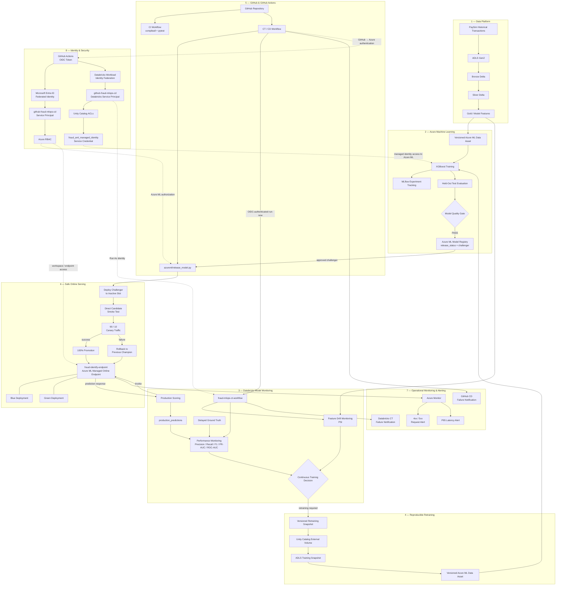
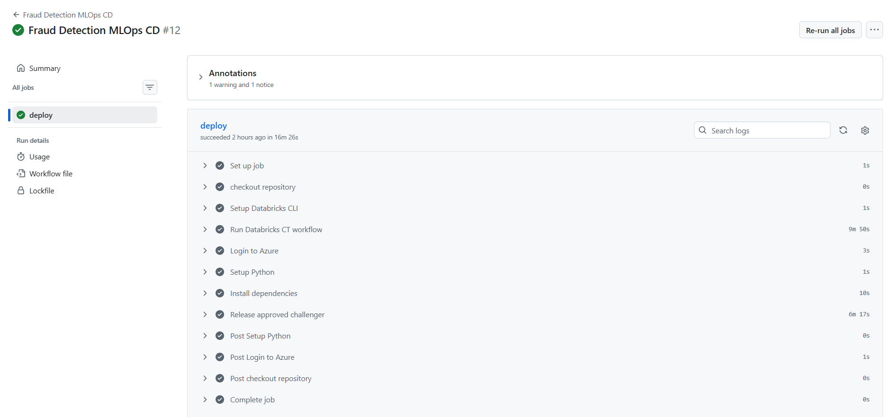
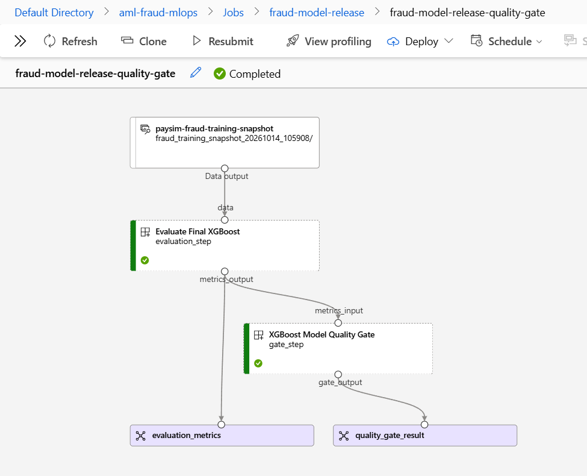
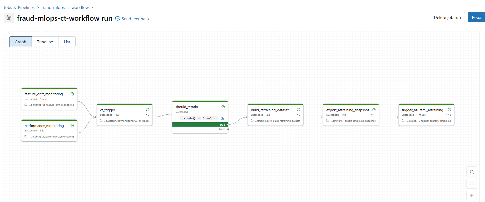
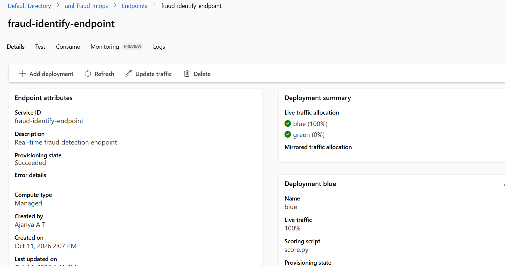
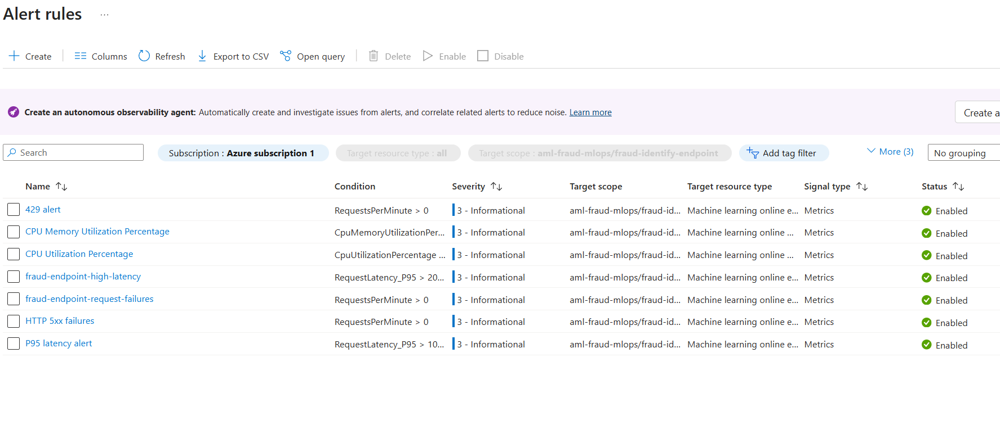
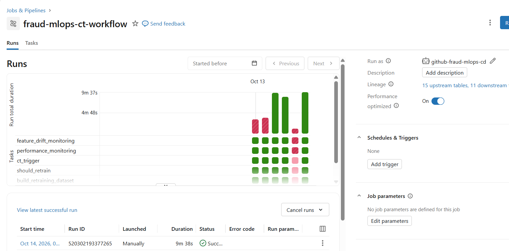

# End-to-End Fraud Detection MLOps Platform on Azure

A production-oriented fraud detection platform built with **Azure Databricks, ADLS Gen2, Azure Machine Learning, MLflow, Unity Catalog, GitHub Actions, XGBoost, and Azure Monitor**.

The platform processes the **PaySim dataset of 6,362,620 money transactions**, including **8,213 fraudulent transactions (~0.129%)**, through a governed Databricks medallion pipeline and an end-to-end Azure MLOps lifecycle.

It implements reproducible retraining, validation-based threshold selection, model quality gates, registry-driven promotion, feature-drift and delayed-label performance monitoring, Continuous Training, CI/CD, blue/green deployment, rollback, operational alerting, and workload-identity security.

> **CI proves the code. CT creates a qualified model. CD safely moves that model into production.**

---

## Production Engineering Highlights

| Capability | Implementation |
|---|---|
| Data platform | ADLS Gen2 + Databricks Delta |
| Model | XGBoost fraud classifier |
| Experiment tracking | MLflow |
| Automated tests | **24** |
| Release governance | Recall / PR-AUC / ROC-AUC quality gate |
| Drift monitoring | PSI across **12 features** |
| Continuous Training | Databricks Workflows |
| CI/CD | GitHub Actions |
| Serving | Azure ML Managed Online Endpoint |
| Deployment strategy | Blue/green with **90/10 → 100%** promotion |
| Rollback | Previous champion retained |
| Observed P95 latency | **≈ 12 ms (validation workload)** |
| Authentication | GitHub OIDC / workload identity federation |
| Runtime identity | Non-human service principal |
| Operational alerts | Request failures + P95 latency |

---

## Architecture


The architecture deliberately separates **data engineering, model qualification, model monitoring, retraining, registry governance, and production release** so that training completion does not directly imply production deployment.

For a deeper breakdown of trust boundaries, release controls, monitoring, and failure handling, see [`docs/architecture.md`](docs/architecture.md).


### End-to-End Automation — Verified





> **End-to-end CT/CD validation:** GitHub Actions authenticates to Databricks, executes the production CT workflow, authenticates to Azure, and runs the production release controller for an approved challenger.

---

## Why This Project Exists

Many machine learning projects end after:

```text
train model
→ evaluate model
→ save model
```

This project focuses on the engineering problem that begins **after a model has been developed**:

> **How do we qualify, deploy, monitor, retrain and safely replace a machine-learning model in production?**

The platform therefore treats model development and model operations as separate concerns.

A trained model must pass explicit quality gates, enter a governed registry lifecycle, survive deployment validation, and remain observable after release.

The goal is not merely to produce predictions.

The goal is to operate a **traceable, testable, monitored and recoverable ML lifecycle**.

---

## Platform Responsibilities

The architecture assigns clear ownership to each platform instead of concentrating the lifecycle inside one notebook or service.

| Platform | Responsibility |
|---|---|
| **ADLS Gen2** | Durable raw data and retraining-snapshot storage |
| **Azure Databricks** | Bronze/Silver/Gold processing, production scoring, drift monitoring, performance monitoring and CT orchestration |
| **Delta Lake** | Versioned analytical tables across the data lifecycle |
| **Unity Catalog** | Data governance, volume permissions and service-credential access |
| **Azure Machine Learning** | Training, evaluation, quality gates, model registry and managed online serving |
| **MLflow** | Experiment tracking, parameters, metrics and model artifacts |
| **GitHub** | Source control and pull-request workflow |
| **GitHub Actions** | CI and production CT/CD orchestration |
| **Azure Monitor** | Endpoint operational monitoring and alerting |
| **Microsoft Entra ID** | Federated identity and Azure authorization |

---

## Data Engineering

Historical PaySim transaction data is processed through a Databricks medallion architecture:

```text
ADLS Gen2
 ↓
Bronze
 ↓
Silver
 ↓
Gold
```

### Bronze

Preserves the ingested transaction data as the raw analytical foundation.

### Silver

Applies cleaning, normalization and transformation required by downstream ML workflows.

### Gold

Produces model-ready features consumed by training, drift monitoring, performance monitoring and retraining workflows.
The separation ensures that raw data, transformed data and model-consumable data remain independently traceable and governed.

### Dataset

This project uses the **PaySim synthetic mobile-money fraud dataset**, generated by the PaySim simulator to reproduce transaction patterns while injecting fraudulent behavior.

The dataset is used for model-development and MLOps demonstration purposes; it does not contain real customer transaction records.

Dataset attribution: E. A. Lopez-Rojas, A. Elmir, and S. Axelsson, *PaySim: A Financial Mobile Money Simulator for Fraud Detection* (2016).

---

## Model Development & Operating Threshold

The classifier uses **XGBoost** for fraud detection.

Because fraud is a highly imbalanced classification problem, plain accuracy is not used as the primary model-selection criterion.

Model evaluation focuses on:

- Precision
- Recall
- F1
- PR-AUC
- ROC-AUC
- False Positive Rate

### Threshold Selection

The production classification threshold is selected using **validation data only**.

```text
Generate validation probabilities
            ↓
Evaluate candidate thresholds
            ↓
Retain thresholds with Recall >= 0.70
            ↓
Maximize Precision among eligible thresholds
            ↓
LOCK threshold
            ↓
Evaluate once on held-out test data
```

This prevents the held-out test set from influencing threshold selection.

The threshold-selection policy is persisted with model metadata:

```text
threshold_policy = recall_70_max_precision
```

---

## Model Quality Gate

Training success does **not** make a model production-eligible.

Every candidate must satisfy explicit release criteria before it can enter the deployment lifecycle.

| Metric | Release Rule | Effective Minimum |
|---|---|---:|
| Recall | `Recall >= 0.70` | **0.700000** |
| PR-AUC | `Test PR-AUC >= 90% of reference validation PR-AUC` | **0.240627** |
| ROC-AUC | `Test ROC-AUC >= reference validation ROC-AUC - 0.03` | **0.891279** |

A representative approved challenger achieved:

| Metric | Candidate | Required |
|---|---:|---:|
| Recall | **0.706869** | >= 0.700000 |
| PR-AUC | **0.333139** | >= 0.240627 |
| ROC-AUC | **0.916218** | >= 0.891279 |
| Operating threshold | **0.430271** | selected on validation |

Only models that **PASS** all release criteria are registered as deployment challengers.

### Model Qualification Evidence





> Model candidates must satisfy the configured Recall, PR-AUC and ROC-AUC release criteria before becoming deployment eligible.

---

## Model Registry Lifecycle

Qualified models are registered in Azure Machine Learning under:

```text
fraud-xgboost
```

Each registered version carries lifecycle metadata:

```text
quality_gate
release_status
data_version
threshold_policy
```

Typical lifecycle:

```text
challenger
    ↓
champion
    ↓
rollback
```

Example metadata:

```text
quality_gate     = passed
release_status   = challenger
data_version     = <snapshot identifier>
threshold_policy = recall_70_max_precision
```

The registry acts as the formal **CT → CD contract**:

```text
Continuous Training
        ↓
qualified challenger
        ↓
Azure ML Model Registry
        ↓
Continuous Delivery
        ↓
production
```

A successful training run therefore cannot directly replace the production model.

---

## Model Monitoring

Model quality monitoring is kept separate from serving-infrastructure monitoring.

### Feature Drift

Feature distributions are compared with a historical reference using **Population Stability Index (PSI)**.

Drift metrics are persisted in:

```text
fraud_mlops.gold.feature_drift_metrics
```

| Monitoring Parameter | Value |
|---|---:|
| Historical reference rows | **6,082,007** |
| Current monitoring window | **10,000 rows** |
| Monitored features | **12** |
| CT drift trigger | **PSI >= 0.20** |

Reporting interpretation:

```text
PSI < 0.10
→ LOW

0.10 <= PSI < 0.25
→ MODERATE

PSI >= 0.25
→ HIGH
```

The production CT policy intentionally uses the more sensitive trigger:

```text
PSI >= 0.20
```

### Production Predictions

Production scoring results are persisted in:

```text
fraud_mlops.gold.production_predictions
```

This creates an auditable record of production prediction behavior.

### Delayed Ground Truth

Fraud labels are modeled as delayed rather than instantly available.

Matured labels are stored in:

```text
fraud_mlops.gold.production_ground_truth
```

This allows the platform to distinguish between:

```text
input-distribution change
```

and:

```text
actual predictive-performance degradation
```

### Performance Monitoring

Once labels become available, the workflow calculates:

```text
Precision
Recall
F1
PR-AUC
ROC-AUC
```

Results are persisted in:

```text
fraud_mlops.gold.model_performance_metrics
```
For detailed monitoring logic, PSI interpretation, and production thresholds, see `docs/monitoring.md`.

---

## Continuous Training (CT)

Continuous Training evaluates both **feature-distribution change** and **observed production-model performance**.

Retraining becomes eligible when at least one monitored condition is breached:

| Signal | Retraining Condition |
|---|---:|
| Feature drift | **PSI >= 0.20** |
| Recall | **< 0.70** |
| PR-AUC | **< 0.240627** |
| ROC-AUC | **< 0.891279** |

The trigger decision and trigger reason are persisted for traceability.

The production Databricks workflow is:

```text
fraud-mlops-ct-workflow
```

Workflow:

```text
feature_drift_monitoring ─────────┐
                                  │
performance_monitoring ───────────┤
                                  ↓
                              ct_trigger
                                  ↓
                           should_retrain
                                  ↓
                    build_retraining_dataset
                                  ↓
                    export_retraining_snapshot
                                  ↓
                   trigger_azureml_retraining
                                  ↓
                    evaluation + quality gate
                                  ↓
                       register challenger
```

A failure in monitoring, dataset preparation, export, training or evaluation prevents downstream model promotion.

The workflow executes using a **non-human service principal** rather than a personal runtime identity.

### Continuous Training Workflow — Verified





> Drift and delayed-label performance monitoring converge on an explicit retraining decision before a versioned training snapshot is exported and submitted to Azure Machine Learning.

---

## Reproducible Retraining

Retraining does not execute directly against mutable production tables.

Each eligible CT cycle materializes a versioned training dataset:

```text
Historical training data
          +
Matured production observations
          ↓
Versioned retraining snapshot
          ↓
Unity Catalog external volume
          ↓
ADLS Gen2
          ↓
Versioned Azure ML Data Asset
```

Each retraining snapshot receives a unique identifier that is propagated into model metadata as:

```text
data_version
```

This creates traceability across:

```text
production model
      ↓
registered model version
      ↓
Azure ML training run
      ↓
retraining snapshot
      ↓
source data
```

The model can therefore be traced back to the exact versioned dataset used to create it.

---

## CI — Continuous Integration

Continuous Integration validates **code quality and release-critical MLOps logic** independently of model training and model promotion.

GitHub Actions executes:

```text
checkout repository
        ↓
setup Python
        ↓
install dependencies
        ↓
python -m compileall
        ↓
pytest
```

Current automated test suite:

```text
24 tests
```

Release-critical logic has been extracted from notebooks into reusable Python modules:

```text
fraud_mlops/ct_logic.py
fraud_mlops/drift_logic.py
fraud_mlops/split_logic.py
fraud_mlops/azureml_retraining.py
```

This makes MLOps decision logic testable, reviewable and enforceable through CI rather than leaving it embedded only inside interactive notebooks.

---

## Continuous Delivery & Safe Model Release

Continuous Delivery releases an **already qualified** Azure ML model rather than training a new model during deployment.

The release controller is:

```text
azureml/release_model.py
```

### Challenger Selection

CD searches the registry for the newest model satisfying:

```text
quality_gate = passed
release_status = challenger
```

If no eligible challenger exists, production is left unchanged.

### Blue/Green Release

The managed endpoint maintains two deployment slots:

```text
blue
green
```

At any point, one slot owns production traffic and the other acts as the candidate/rollback slot.

Example release:

```text
Initial state

blue  = 100%
green =   0%

        ↓

Deploy challenger to green

blue  = 100%
green = candidate / 0%

        ↓

Direct candidate smoke test

        ↓

Canary

blue  = 90%
green = 10%

        ↓

Promotion

blue  =   0%
green = 100%
```

On the next release, the roles reverse.

Azure Machine Learning documents this staged blue/green pattern as a safe rollout strategy: create an inactive deployment, test it independently, send a small percentage of live traffic, then shift all traffic after validation.

### Release Safeguards

Before full promotion the release controller requires:

```text
approved challenger
        ↓
clean 100/0 endpoint state
        ↓
candidate deployment succeeds
        ↓
direct candidate smoke test succeeds
        ↓
90/10 live traffic allocation
        ↓
candidate validation succeeds
        ↓
100% promotion
```

If validation fails after traffic shifting begins, traffic is restored to the previous production deployment.

GitHub Actions also uses a production concurrency group to prevent overlapping release executions.

> The current canary validates deployability and scoring availability. Statistical health monitoring is handled separately through production monitoring rather than being overclaimed as part of the canary.

### Blue/Green Deployment — Verified





> The managed endpoint keeps an active production slot and an inactive candidate/rollback slot so new model versions can be introduced without replacing the serving deployment in place.

---

## Online Serving & Observed Endpoint Performance

Models are served through:

```text
fraud-identify-endpoint
```

using an **Azure Machine Learning Managed Online Endpoint**.

Inference returns:

```json
{
  "fraud_probability": [...],
  "fraud_prediction": [...]
}
```

The locked operating threshold is applied by the scoring implementation rather than relying on the default classification threshold of `0.5`.

### Observed Serving Benchmark

Deployment configuration during the observation window:

| Property | Value |
|---|---|
| Endpoint | `fraud-identify-endpoint` |
| Deployment type | Azure ML Managed Online Endpoint |
| Compute | `Standard_DS2_v2` |

Observed Azure Monitor metrics:

| Metric | Observed Value |
|---|---:|
| P50 request latency | **≈ 8 ms** |
| P95 request latency | **≈ 12 ms** |
| P99 request latency | **≈ 14 ms** |
| CPU utilization | **≈ 0.3%** |
| Memory utilization | **≈ 4.3%** |
| Disk utilization | **≈ 29%** |

The observed window showed low resource pressure and a relatively compact latency distribution.

> **These values are observations from the validation workload, not a production SLA or formal load-test result.** Capacity planning should be based on representative production traffic, concurrency and availability requirements.

For additional benchmark detail, see [`docs/serving-benchmark.md`](docs/serving-benchmark.md).

---

## Measured Model Results

### Held-Out Test Evaluation

A separate validated reference release produced the following held-out evaluation:

| Metric | Value |
|---|---:|
| PR-AUC | **0.347941** |
| ROC-AUC | **0.918942** |
| Precision | **0.098103** |
| Recall | **0.706592** |
| F1 | **0.172285** |
| False Positive Rate | **0.091607** |

These metrics are from a different validated release than the representative challenger shown in the Model Quality Gate section above.

Confusion matrix:

| | Predicted Fraud | Predicted Normal |
|---|---:|---:|
| **Actual Fraud** | **879** | **365** |
| **Actual Normal** | **8,081** | **80,133** |

The operating point deliberately constrains recall to approximately 70% and then maximizes precision subject to that recall requirement.

In an imbalanced fraud problem, this makes the business trade-off explicit rather than optimizing for misleading overall accuracy.

For full metric derivations and evaluation methodology, see [`docs/model-evaluation.md`](docs/model-evaluation.md).

---

## Observed End-to-End Pipeline Runtime

A successful integrated GitHub Actions run demonstrated the complete CT/CD chain:

```text
GitHub Actions
    ↓
Databricks CT
    ↓
Azure ML retraining / evaluation
    ↓
Registry
    ↓
Blue-green release
```

One observed successful execution:

| Stage | Observed Runtime |
|---|---:|
| Databricks CT workflow | **≈ 9m 50s** |
| Production release step | **≈ 6m 17s** |
| End-to-end GitHub workflow | **≈ 16m 26s** |

These timings are execution observations rather than pipeline SLAs.

---

## Operational Monitoring & Alerting

The platform deliberately separates **model-quality monitoring** from **serving-infrastructure monitoring**.

### Model Health — Databricks

Databricks monitors:

```text
feature drift
delayed-label model performance
CT trigger state
workflow health
```

### Service Health — Azure Monitor

Azure Monitor monitors:

```text
HTTP request failures
P95 inference latency
endpoint operational health
```

### Alerting Policy

| Signal | Threshold / Condition | Platform | Response |
|---|---|---|---|
| Endpoint request failures | `4xx or 5xx > 0` | Azure Monitor | Alert |
| P95 inference latency | `> 2,000 ms` initial guardrail | Azure Monitor | Alert |
| Feature drift | `PSI >= 0.20` | Databricks | CT condition |
| Recall degradation | `< 0.70` | Databricks | CT condition |
| PR-AUC degradation | `< 0.240627` | Databricks | CT condition |
| ROC-AUC degradation | `< 0.891279` | Databricks | CT condition |
| CT workflow failure | Job failure | Databricks | Email notification |
| CD workflow failure | Workflow failure | GitHub Actions | Workflow notification |

> The current latency threshold is an initial operational guardrail rather than a formal SLO. A production threshold should be calibrated using representative load testing, expected concurrency, and business latency requirements.

This separation answers two different operational questions:

```text
Is the serving endpoint healthy?
```

versus:

```text
Is the model still statistically effective?
```

### Operational Alerts — Verified





> Azure Monitor protects the managed endpoint with request-failure and P95-latency alert rules, while Databricks separately monitors model-quality signals.

---

## Security Architecture

The project avoids long-lived CI/CD cloud credentials.

### GitHub → Azure

```text
GitHub Actions
      ↓
OIDC token
      ↓
Microsoft Entra ID
      ↓
github-fraud-mlops-cd
      ↓
Azure RBAC
      ↓
Azure Machine Learning
```

There is no Azure client secret stored in GitHub Actions.

---

### GitHub → Databricks

```text
GitHub Actions
      ↓
GitHub OIDC
      ↓
Databricks workload identity federation
      ↓
github-fraud-mlops-cd
      ↓
fraud-mlops-ct-workflow
```

There is no Databricks PAT stored in GitHub Actions.

---

### Databricks Runtime Identity

The production workflow executes as:

```text
github-fraud-mlops-cd
```

rather than a personal user.

The service principal receives only the permissions required by the workflow.

Examples include:

```text
USE CATALOG
USE SCHEMA
SELECT
MODIFY
CREATE TABLE
READ VOLUME
WRITE VOLUME
ACCESS service credential
CAN MANAGE RUN
```

The Databricks service credential used for Azure ML access is:

```text
fraud_aml_managed_identity
```
### Production Runtime Identity — Verified





> The production CT workflow executes using a non-human service principal rather than a personal Databricks identity.

---

## Failure Boundaries

A production ML system must fail safely and preserve the last known-good production state whenever possible.

| Failure | Behavior |
|---|---|
| CI test failure | Code is not considered ready |
| Drift/performance task failure | CT workflow stops |
| Azure ML retraining failure | No challenger produced |
| Quality-gate failure | Model is not release eligible |
| Candidate deployment failure | Existing production remains active |
| Candidate smoke-test failure | Promotion stops |
| Canary-stage failure | Traffic returns to previous production slot |
| Registry metadata update failure | Serving remains active and warning is emitted |
| Concurrent deployment attempt | GitHub concurrency prevents overlap |
| Endpoint failure/latency issue | Azure Monitor alert fires |

A central design principle is:

> **Training success is not release approval, and release approval is not production promotion.**
> For incident response, rollback, and operational recovery procedures, see `docs/operations-runbook.md`.

---

## Repository Structure

```text
fraud-detection-mlops/
│
├── .azureml/
│   └── config.json
│
├── .github/
│   └── workflows/
│       ├── ci.yml
│       └── cd.yml
│
├── azureml/
│   ├── environment/
│   ├── online_scoring/
│   ├── src/
│   ├── release_model.py
│   └── sample_request.json
│
├── databricks/
│   ├── labels/
│   ├── monitoring/
│   ├── retraining/
│   └── scoring/
│
├── incremental/
│   ├── 01_landing_to_bronze.py.ipynb
│   ├── 02_bronze_to_silver.py.ipynb
│   └── 03_silver_to_gold.py.ipynb
│
├── fraud_mlops/
│   ├── azureml_retraining.py
│   ├── ct_logic.py
│   ├── drift_logic.py
│   └── split_logic.py
│
├── tests/
│
├── docs/
│   ├── images/
│   ├── architecture.md
│   ├── model-evaluation.md
│   ├── monitoring.md
│   ├── serving-benchmark.md
│   └── operations-runbook.md
│
├── SECURITY.md
├── requirements.txt
└── README.md
```

---

## Key Engineering Decisions

### Managed Azure ML Serving

The project uses Azure ML Managed Online Endpoints so the engineering focus remains on:

```text
model lifecycle
quality gates
safe deployment
monitoring
rollback
identity
```

rather than introducing infrastructure components that are not required by this implementation.

---

### Registry as a Release Boundary

Continuous training and continuous delivery are intentionally decoupled.

```text
CT
 ↓
qualified challenger
 ↓
Model Registry
 ↓
CD
 ↓
production
```

This prevents a training pipeline from directly replacing the production model.

---

### Delayed Labels

Fraud labels are not assumed to exist immediately when a transaction is scored.

This allows the platform to model a more realistic production distinction between:

```text
input distribution changes
```

and:

```text
true predictive performance
```

---

### Shared Python Logic

Critical production decisions live in reusable Python modules rather than only in notebooks.

This improves:

```text
testability
maintainability
reviewability
CI coverage
```
---

## How to Review This Repository in 5 Minutes

| Area | Location | What It Demonstrates |
|---|---|---|
| System overview | `README.md` | End-to-end MLOps lifecycle |
| Architecture | `docs/architecture.md` | Component, control and trust boundaries |
| Core MLOps logic | `fraud_mlops/` | Reusable, testable production logic |
| Monitoring | `databricks/monitoring/` | Drift + delayed-label performance monitoring |
| Retraining | `databricks/retraining/` | Versioned retraining lifecycle |
| Azure ML | `azureml/` | Training, scoring and release implementation |
| Release controller | `azureml/release_model.py` | Blue/green promotion and rollback |
| CI/CD | `.github/workflows/` | Automated CI and CT/CD |
| Tests | `tests/` | Automated validation |
| Security | `SECURITY.md` | Federated identity and least privilege |

---

## Technology Stack

| Area | Technologies |
|---|---|
| Cloud | Microsoft Azure, Azure Machine Learning, Azure Monitor, ADLS Gen2, Microsoft Entra ID |
| Data Engineering | Azure Databricks, PySpark, Delta Lake, Unity Catalog |
| Machine Learning | Python, XGBoost, scikit-learn, MLflow |
| MLOps | Azure ML Model Registry, Managed Online Endpoints, Databricks Workflows, GitHub Actions |
| Release Engineering | CI/CD, Continuous Training, blue/green deployment, canary rollout, rollback |
| Monitoring | PSI drift monitoring, delayed-label performance monitoring, Azure Monitor |
| Security | OIDC federation, workload identity federation, service principals, Azure RBAC, Unity Catalog ACLs, managed identity |
| Quality | pytest, compile checks, model quality gates, smoke tests |

---

## Validation

Local code validation:

```bash
python -m compileall azureml fraud_mlops tests
python -m pytest tests -v
```

Current automated test suite:

```text
24 tests
```
The same validation commands are executed through GitHub Actions CI before code is considered release-ready.

---

## Scope & Extension Points

This repository validates a production-oriented MLOps control plane using a finite PaySim fraud dataset.

The implemented lifecycle covers:

```text
data engineering
model training
experiment tracking
model qualification
registry governance
managed online deployment
model monitoring
Continuous Training
CI/CD
rollback
operational alerting
identity security
```

The architecture is designed so that continuously arriving production data could be incorporated without redesigning the model-release boundary.

Natural extensions for continuously updated data include:

```text
data-arrival-aware retraining
watermarking
idempotent ingestion
freshness controls
event-driven CT
```

The project intentionally uses **Azure Machine Learning Managed Online Endpoints** for serving. Kubernetes-based serving and infrastructure-as-code are separate infrastructure concerns and are outside the implemented scope of this repository.

---

## Author

**Sarath Kumar Komathukattil**

Machine Learning Engineering · MLOps · Applied AI
