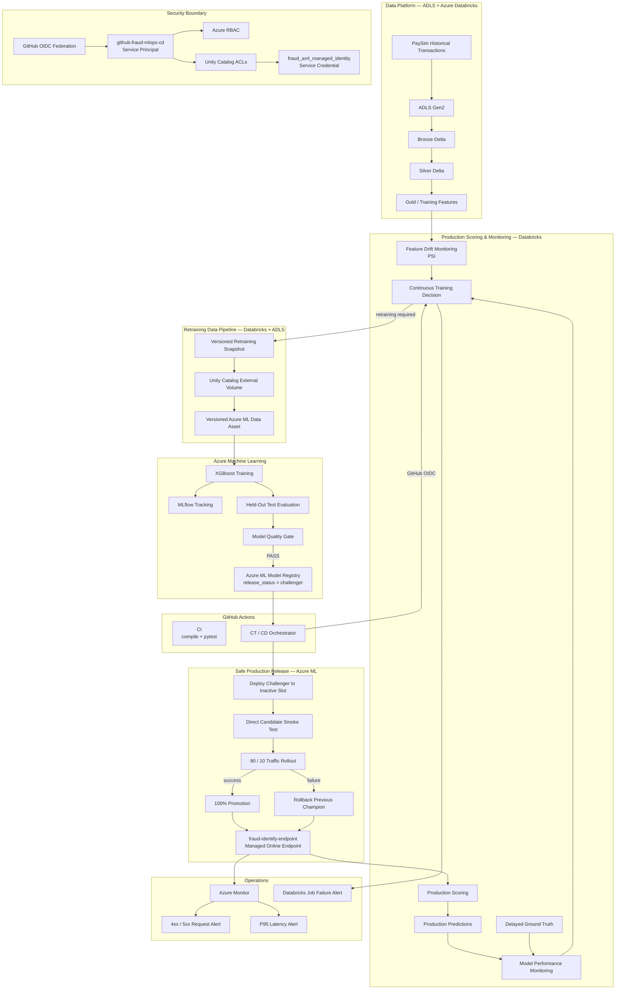

# End-to-End Fraud Detection MLOps Platform on Azure

A production-oriented machine learning platform for fraud detection built with **Azure Databricks, ADLS Gen2, Azure Machine Learning, MLflow, Unity Catalog, GitHub Actions, XGBoost, and Azure Monitor**.

This project goes beyond training a model. It implements the operational controls required to move machine learning from experimentation toward production:

- governed Bronze / Silver / Gold data pipelines
- reproducible and versioned retraining datasets
- MLflow experiment tracking
- imbalance-aware model evaluation
- validation/test separation
- explicit model quality gates
- model registry lifecycle management
- feature drift monitoring
- delayed-label performance monitoring
- continuous-training orchestration
- automated CI / CT / CD
- blue/green deployment
- canary traffic rollout
- automatic rollback
- endpoint health monitoring
- alerting
- workload identity federation
- service-principal execution
- least-privilege access

> **CI proves the code. CT creates a qualified model. CD safely moves that model into production.**

---

## Why This Project Exists

Most machine learning portfolio projects stop at:

```text
train model
→ evaluate model
→ save model
```

This repository focuses on the harder engineering problem:

```text
How do we operate a machine-learning system safely after the first model has been trained?
```

The system therefore separates:

```text
Data engineering
       ↓
Model development
       ↓
Model qualification
       ↓
Model registration
       ↓
Production release
       ↓
Monitoring
       ↓
Continuous training
       ↓
Safe model replacement
```

The goal is not merely to produce predictions.

The goal is to build a **traceable, testable, monitored and recoverable ML lifecycle**.

---

# Architecture



---

# Platform Responsibilities

The architecture deliberately separates responsibilities instead of creating one large notebook or pipeline.

| Platform | Responsibility |
|---|---|
| **ADLS Gen2** | Persistent raw and retraining data storage |
| **Azure Databricks** | Bronze/Silver/Gold processing, production scoring, drift monitoring, performance monitoring and CT orchestration |
| **Unity Catalog** | Data governance, volume permissions and service-credential access |
| **Azure Machine Learning** | Training, evaluation, quality gate, model registry and online serving |
| **MLflow** | Experiment tracking, parameters, metrics and model artifacts |
| **GitHub** | Source control and pull-request workflow |
| **GitHub Actions** | CI and production CT/CD orchestration |
| **Azure Monitor** | Online endpoint operational monitoring and alerts |
| **Microsoft Entra ID** | Federated identities and service-principal authentication |

---

# Data Engineering

Historical PaySim transactions are processed using a medallion architecture:

```text
ADLS
 ↓
Bronze
 ↓
Silver
 ↓
Gold
```

### Bronze

Raw transaction ingestion.

### Silver

Cleaning, normalization and transformation.

### Gold

Model-ready features used for training, monitoring and retraining.

This separation keeps raw data, transformed data and model-consumable datasets independently governed and traceable.

---

# Machine Learning

The production model is based on **XGBoost**.

Fraud detection is highly imbalanced, therefore simple accuracy is not used as the primary release criterion.

The workflow evaluates metrics that are more meaningful for rare-event classification:

- Precision
- Recall
- F1
- PR-AUC
- ROC-AUC
- False Positive Rate

---

# Operating Threshold Policy

The classification threshold is **not selected using the test set**.

The release methodology is:

```text
Train
   ↓
Validation probabilities
   ↓
Find thresholds satisfying recall >= 0.70
   ↓
Among valid thresholds,
maximize precision
   ↓
LOCK threshold
   ↓
Evaluate once on held-out test data
```

This avoids tuning the production operating point against test data.

The threshold-selection policy is stored with model lifecycle metadata:

```text
threshold_policy = recall_70_max_precision
```

---

# Model Quality Gate

Training success does not automatically make a model deployable.

A candidate must satisfy all release criteria.

```text
Recall      >= 0.70

Test PR-AUC >= 90% of reference validation PR-AUC

Test ROC-AUC >= reference validation ROC-AUC - 0.03
```

For this project the effective release thresholds are approximately:

```text
Recall      >= 0.700
PR-AUC      >= 0.241
ROC-AUC     >= 0.891
```

A representative qualified release produced approximately:

```text
PR-AUC      0.333
ROC-AUC     0.916
Recall      0.707
```

Only models that pass the gate are registered as deployment challengers.

---

# Model Registry Lifecycle

Approved models are registered in Azure Machine Learning under:

```text
fraud-xgboost
```

Lifecycle metadata includes:

```text
quality_gate
release_status
data_version
threshold_policy
```

For example:

```text
quality_gate    = passed
release_status  = challenger
data_version    = <snapshot identifier>
threshold_policy = recall_70_max_precision
```

This turns the model registry into a formal boundary between:

```text
model creation
```

and:

```text
production release
```

---

# Production Model Monitoring

The project distinguishes several different production signals.

## 1. Feature Drift

Feature distributions are compared against historical reference data using **Population Stability Index (PSI)**.

Drift metrics are persisted in:

```text
fraud_mlops.gold.feature_drift_metrics
```

The CT trigger currently considers feature drift actionable at:

```text
PSI >= 0.20
```

---

## 2. Production Predictions

Endpoint predictions are stored in:

```text
fraud_mlops.gold.production_predictions
```

This provides an auditable record of production scoring behavior.

---

## 3. Delayed Ground Truth

Fraud labels are treated as delayed rather than instantly available.

Ground truth is stored in:

```text
fraud_mlops.gold.production_ground_truth
```

This allows the platform to distinguish:

```text
feature drift
```

from:

```text
actual model-performance degradation
```

---

## 4. Performance Monitoring

Once labels are available, the monitoring workflow calculates production metrics including:

```text
Precision
Recall
F1
PR-AUC
ROC-AUC
```

Metrics are persisted in:

```text
fraud_mlops.gold.model_performance_metrics
```

---

# Continuous Training

The CT workflow evaluates both drift and model performance.

Conceptually:

```text
Feature Drift ──────────────┐
                            │
Production Performance ─────┼──> CT Decision
                            │
Quality Thresholds ─────────┘
```

Retraining can be triggered when:

```text
PSI >= 0.20

OR

Recall < 0.70

OR

PR-AUC < 0.241

OR

ROC-AUC < 0.891
```

The trigger decision and reason are persisted for traceability.

---

# Reproducible Retraining

A retraining cycle does not directly train against mutable production tables.

Instead:

```text
Historical training data
        +
Matured production observations
        ↓
Versioned retraining snapshot
        ↓
Unity Catalog external volume
        ↓
ADLS
        ↓
Versioned Azure ML Data Asset
```

Each retraining run produces a unique snapshot identifier.

That identifier is carried into model metadata so a model can be traced back to the data used to create it.

---

# CI — Continuous Integration

CI is responsible for validating **code**, not promoting models.

GitHub Actions runs:

```text
checkout repository
        ↓
setup Python
        ↓
install dependencies
        ↓
python -m compileall
        ↓
pytest
```

The repository currently contains **24 automated tests**.

Core MLOps logic has been moved from notebook-only implementation into reusable Python modules so it can be tested by CI.

Examples include:

```text
fraud_mlops/ct_logic.py
fraud_mlops/drift_logic.py
fraud_mlops/split_logic.py
fraud_mlops/azureml_retraining.py
```

This prevents critical release logic from existing only inside interactive notebooks.

---

# CT — Continuous Training

The production Databricks workflow is:

```text
fraud-mlops-ct-workflow
```

High-level task graph:

```text
feature_drift_monitoring ─┐
                          │
performance_monitoring ───┼──> ct_trigger
                          │
                          ↓
                    should_retrain
                          ↓
               build_retraining_dataset
                          ↓
               export_retraining_snapshot
                          ↓
              trigger_azureml_retraining
                          ↓
               evaluation + quality gate
                          ↓
                 register challenger
```

The workflow runs using a dedicated service principal rather than a personal user identity.

---

# CD — Continuous Delivery

CD is responsible for safely releasing an **already qualified** model.

The production release controller is:

```text
azureml/release_model.py
```

The workflow:

```text
Find latest approved challenger
        ↓
Read current endpoint traffic
        ↓
Determine active production slot
        ↓
Determine inactive candidate slot
        ↓
Deploy challenger to inactive slot
        ↓
Wait for provisioning success
        ↓
Direct smoke test
        ↓
90 / 10 traffic allocation
        ↓
Candidate smoke test
        ↓
100% promotion
```

If release validation fails after traffic shifting begins:

```text
100% traffic
        ↓
previous production deployment
```

is restored.

---

# Blue / Green Deployment

The managed endpoint maintains two deployment slots:

```text
blue

green
```

Only one slot owns production traffic at a time.

Example:

```text
Before release

blue  = 100%
green =   0%
```

A new challenger is deployed to the inactive slot:

```text
blue  = 100%
green = candidate
```

After validation:

```text
blue  = 90%
green = 10%
```

After successful rollout:

```text
blue  = 0%
green = 100%
```

On the next release the roles reverse.

The previous production deployment is retained as the immediate rollback target.

---

# Deployment Safety

The release controller includes several safeguards:

```text
approved challenger required
        ↓
endpoint must be in clean 100/0 state
        ↓
candidate provisioning must succeed
        ↓
candidate must answer smoke request
        ↓
limited traffic rollout
        ↓
second candidate validation
        ↓
full promotion
```

GitHub Actions also uses a production concurrency group so overlapping production releases cannot execute simultaneously.

The current canary implementation validates candidate availability around the traffic shift. Operational endpoint health is monitored separately through Azure Monitor.

---

# Online Serving

Models are served through:

```text
fraud-identify-endpoint
```

using an **Azure Machine Learning Managed Online Endpoint**.

Inference returns:

```json
{
  "fraud_probability": [...],
  "fraud_prediction": [...]
}
```

The production operating threshold is applied by the scoring implementation rather than relying on a default `0.5` classification threshold.

---

# Measured System Results

The values below are measurements from the implemented platform rather than theoretical targets.

## Model Release Criteria

Model promotion is controlled by explicit quality gates derived from the original validation baseline.

| Metric | Reference Validation | Release Rule | Effective Minimum |
|---|---:|---:|---:|
| Recall | — | `>= 0.70` | **0.7000** |
| PR-AUC | 0.267363 | `>= 90% of validation PR-AUC` | **0.240627** |
| ROC-AUC | 0.921279 | `>= validation ROC-AUC - 0.03` | **0.891279** |

### Gate calculations

```text
Minimum PR-AUC
= 0.2673629652 × 0.90
= 0.2406266687

Minimum ROC-AUC
= 0.9212790418 - 0.03
= 0.8912790418

Minimum Recall
= 0.70
```

A representative approved challenger achieved:

| Metric | Result | Gate |
|---|---:|---:|
| Recall | **0.706869** | >= 0.700000 |
| PR-AUC | **0.333139** | >= 0.240627 |
| ROC-AUC | **0.916218** | >= 0.891279 |
| Operating threshold | **0.430271** | selected on validation |

The classification threshold is selected using validation data only:

```text
candidate thresholds
        ↓
retain thresholds where recall >= 0.70
        ↓
select threshold with highest precision
        ↓
lock threshold
        ↓
evaluate once on held-out test data
```

This prevents threshold tuning against the test set.

---

## Reference Held-Out Test Evaluation

One evaluated production candidate produced the following confusion matrix:

| | Predicted Fraud | Predicted Normal |
|---|---:|---:|
| **Actual Fraud** | TP = 879 | FN = 365 |
| **Actual Normal** | FP = 8,081 | TN = 80,133 |

### Derived metrics

```text
Precision
= TP / (TP + FP)

= 879 / (879 + 8081)

= 0.098103
```

```text
Recall
= TP / (TP + FN)

= 879 / (879 + 365)

= 0.706592
```

```text
F1
= 2 × Precision × Recall
  / (Precision + Recall)

= 0.172285
```

```text
False Positive Rate
= FP / (FP + TN)

= 8081 / (8081 + 80133)

= 0.091607
```

Full held-out metrics:

| Metric | Value |
|---|---:|
| PR-AUC | **0.347941** |
| ROC-AUC | **0.918942** |
| Precision | **0.098103** |
| Recall | **0.706592** |
| F1 | **0.172285** |
| False Positive Rate | **0.091607** |

The relatively low precision is expected for a deliberately recall-constrained fraud operating point on a highly imbalanced dataset; the threshold policy prioritizes detecting at least 70% of fraud events while maximizing precision subject to that recall constraint.

---

## Drift Monitoring Configuration

Feature drift is measured using Population Stability Index (PSI).

```text
PSI
= Σ (current_i - reference_i)
    × ln(current_i / reference_i)
```

Monitoring configuration:

| Parameter | Value |
|---|---:|
| Historical reference rows | **6,082,007** |
| Current drift window | **10,000 rows** |
| Monitored features | **12** |
| CT drift trigger | **PSI >= 0.20** |

Interpretation used for reporting:

```text
PSI < 0.10
→ LOW

0.10 <= PSI < 0.25
→ MODERATE

PSI >= 0.25
→ HIGH
```

The operational CT trigger is deliberately more sensitive:

```text
PSI >= 0.20
→ retraining condition
```

---

## Continuous Training Conditions

Retraining is initiated when at least one monitored condition is breached:

```text
PSI >= 0.20

OR

Recall < 0.70

OR

PR-AUC < 0.240627

OR

ROC-AUC < 0.891279
```

This decision is persisted with the trigger reason before retraining begins.

---

# Managed Online Endpoint — Observed Serving Benchmark

Azure Monitor was used to inspect the managed online endpoint during validation.

Deployment configuration at measurement time:

```text
Endpoint:
fraud-identify-endpoint

Compute SKU:
Standard_DS2_v2

Deployment type:
Azure ML Managed Online Endpoint
```

Observed metrics:

| Metric | Observed Value |
|---|---:|
| P50 request latency | **≈ 8 ms** |
| P95 request latency | **≈ 12 ms** |
| P99 request latency | **≈ 14 ms** |
| CPU utilization | **≈ 0.3%** |
| Memory utilization | **≈ 4.3%** |
| Disk utilization | **≈ 29%** |

### Derived resource headroom

```text
CPU headroom
= 100% - 0.3%
= 99.7%
```

```text
Memory headroom
= 100% - 4.3%
= 95.7%
```

```text
Available disk percentage
= 100% - 29%
= 71%
```

### Tail-latency spread

```text
P95 - P50
= 12 ms - 8 ms
= 4 ms
```

```text
P99 - P95
= 14 ms - 12 ms
= 2 ms
```

```text
P99 / P50
= 14 / 8
≈ 1.75×
```

These measurements demonstrate low resource pressure and a compact tail-latency spread during the observed validation workload.

> These values represent an observed test window, not a guaranteed production SLA. Production sizing should be based on representative traffic volume, concurrency, availability requirements and load testing.

---

## Automated Pipeline Runtime

A successful integrated GitHub Actions run demonstrated the complete CT/CD chain:

```text
GitHub Actions
    ↓
Databricks CT
    ↓
Azure ML retraining / evaluation
    ↓
Registry
    ↓
Blue-green release
```

Observed execution:

| Stage | Observed Runtime |
|---|---:|
| Databricks CT workflow | **≈ 9m 50s** |
| Production release step | **≈ 6m 17s** |
| End-to-end GitHub workflow | **≈ 16m 26s** |

These timings are execution observations rather than pipeline SLAs.

---

## Operational Alert Thresholds

| Signal | Threshold / Condition | Platform |
|---|---|---|
| Endpoint request failures | **4xx or 5xx > 0** | Azure Monitor |
| P95 inference latency | **> 2,000 ms** | Azure Monitor |
| Feature drift | **PSI >= 0.20** | Databricks |
| Recall degradation | **< 0.70** | Databricks |
| PR-AUC degradation | **< 0.240627** | Databricks |
| ROC-AUC degradation | **< 0.891279** | Databricks |
| CT workflow failure | **Job failure** | Databricks notification |
| Production CD failure | **Workflow failure** | GitHub Actions |

---

# Operational Monitoring

Model monitoring and infrastructure monitoring are deliberately separated.

## Model Health

Handled in Databricks:

```text
feature drift
model performance
CT decision
```

## Service Health

Handled through Azure Monitor:

```text
HTTP request failures
P95 inference latency
endpoint health
```

Two Azure Monitor alert rules protect the managed online endpoint:

```text
4xx / 5xx request failures

P95 latency threshold
```

Databricks also sends notification when the CT workflow fails.

---

# Security Architecture

The project avoids long-lived CI/CD cloud credentials.

## GitHub → Azure

```text
GitHub Actions
      ↓
OIDC token
      ↓
Microsoft Entra ID
      ↓
github-fraud-mlops-cd
      ↓
Azure RBAC
      ↓
Azure Machine Learning
```

There is no Azure client secret stored in GitHub Actions.

---

## GitHub → Databricks

```text
GitHub Actions
      ↓
GitHub OIDC
      ↓
Databricks workload identity federation
      ↓
github-fraud-mlops-cd
      ↓
fraud-mlops-ct-workflow
```

There is no Databricks PAT stored in GitHub Actions.

---

## Databricks Runtime Identity

The production workflow executes as:

```text
github-fraud-mlops-cd
```

rather than a personal user.

The service principal receives only the permissions required by the workflow.

Examples include:

```text
USE CATALOG
USE SCHEMA
SELECT
MODIFY
CREATE TABLE
READ VOLUME
WRITE VOLUME
ACCESS service credential
CAN MANAGE RUN
```

The Azure ML service credential is:

```text
fraud_aml_managed_identity
```

---

# Failure Boundaries

A production ML system should fail safely.

| Failure | Behavior |
|---|---|
| CI test failure | Code is not considered ready |
| Drift/performance task failure | CT workflow stops |
| Azure ML retraining failure | No challenger produced |
| Quality-gate failure | Model is not release eligible |
| Candidate deployment failure | Existing production remains active |
| Candidate smoke-test failure | Promotion stops |
| Canary-stage failure | Traffic returns to previous production slot |
| Registry metadata update failure | Serving remains active and warning is emitted |
| Concurrent deployment attempt | GitHub concurrency prevents overlap |
| Endpoint failure/latency issue | Azure Monitor alert fires |

A central design principle is:

> **Training success is not release approval, and release approval is not production promotion.**

---

# Repository Structure

```text
fraud-detection-mlops/
│
├── .azureml/
│   └── config.json
│
├── .github/
│   └── workflows/
│       ├── ci.yml
│       └── cd.yml
│
├── azureml/
│   ├── environment/
│   ├── online_scoring/
│   ├── src/
│   ├── release_model.py
│   └── sample_request.json
│
├── databricks/
│   ├── labels/
│   ├── monitoring/
│   ├── retraining/
│   └── scoring/
│
├── incremental/
│   ├── 01_landing_to_bronze.py.ipynb
│   ├── 02_bronze_to_silver.py.ipynb
│   └── 03_silver_to_gold.py.ipynb
│
├── fraud_mlops/
│   ├── azureml_retraining.py
│   ├── ct_logic.py
│   ├── drift_logic.py
│   └── split_logic.py
│
├── tests/
│
├── docs/
│   ├── images/
│   ├── architecture.md
│   └── operations-runbook.md
│
├── SECURITY.md
├── requirements.txt
└── README.md
```

---

# Engineering Decisions

## Managed Azure ML Serving

The project uses Azure ML Managed Online Endpoints so the engineering focus remains on:

```text
model lifecycle
quality gates
safe deployment
monitoring
rollback
identity
```

rather than introducing infrastructure components that are not required by this implementation.

---

## Registry as a Release Boundary

Continuous training and continuous delivery are intentionally decoupled.

```text
CT
 ↓
qualified challenger
 ↓
Model Registry
 ↓
CD
 ↓
production
```

This prevents a training pipeline from directly replacing the production model.

---

## Delayed Labels

Fraud labels are not assumed to exist immediately when a transaction is scored.

This allows the platform to model a more realistic production distinction between:

```text
input distribution changes
```

and:

```text
true predictive performance
```

---

## Shared Python Logic

Critical production decisions live in reusable Python modules rather than only in notebooks.

This improves:

```text
testability
maintainability
reviewability
CI coverage
```

---

## Service Principal Runtime

Production automation executes with an application identity rather than a human account.

This reduces operational dependency on individual users and allows permissions to be scoped specifically to the workflow.

---

# Evidence of the System Running

The repository includes visual evidence of the implemented system:

```text
GitHub CI success

GitHub end-to-end CT/CD success

Databricks CT workflow success

Azure ML quality-gate PASS

Azure ML model registry lifecycle

Blue/green endpoint deployment

Azure Monitor operational alerts

Service-principal execution
```

See:

```text
docs/images/
```

---

# How to Review This Repository in 5 Minutes

If you are evaluating this project for an ML Engineering or MLOps role, start with:

```text
1. README.md
   → complete system overview

2. docs/architecture.md
   → architecture and security boundaries

3. fraud_mlops/
   → reusable production logic

4. databricks/monitoring/
   → drift + performance + CT

5. databricks/retraining/
   → versioned retraining data

6. azureml/
   → training, evaluation and release code

7. azureml/release_model.py
   → blue/green production deployment

8. .github/workflows/
   → CI and CT/CD automation

9. tests/
   → automated validation

10. SECURITY.md
    → identity and least-privilege model
```

---

# Technologies

### Cloud

```text
Microsoft Azure
Azure Machine Learning
Azure Monitor
ADLS Gen2
Microsoft Entra ID
```

### Data Engineering

```text
Azure Databricks
PySpark
Delta Lake
Unity Catalog
```

### Machine Learning

```text
Python
XGBoost
scikit-learn
MLflow
```

### MLOps

```text
Azure ML Model Registry
Managed Online Endpoints
Databricks Workflows
GitHub Actions
Continuous Training
CI/CD
Blue/Green Deployment
Canary Rollout
Rollback
Model Monitoring
```

### Security

```text
OIDC Federation
Workload Identity Federation
Service Principals
Azure RBAC
Unity Catalog ACLs
Managed Identity
```

### Quality

```text
pytest
compile checks
quality gates
smoke tests
drift thresholds
performance thresholds
```

---

# Validation

Local code validation:

```bash
python -m compileall azureml fraud_mlops tests
python -m pytest tests -v
```

Current automated test suite:

```text
24 tests
```

---

# Project Scope

This repository implements the production MLOps control plane against a finite fraud dataset.

The release architecture is designed so that continuously arriving production data can be connected without redesigning the model-release system.

For a continuously updated data source, natural extensions include:

```text
data-arrival-aware retraining
watermarking
idempotent ingestion
freshness controls
event-driven CT
```

These concerns are intentionally kept separate from the implemented fraud-detection lifecycle.

---

# Implemented Scope — No Inflated Claims

This repository implements:

```text
Azure ML Managed Online Endpoints
Azure Databricks
MLflow
ADLS Gen2
Unity Catalog
GitHub Actions
Azure Monitor
OIDC
service-principal automation
```

It does **not** claim implementation of:

```text
Kubernetes
AKS
Terraform
Bicep
ACR
Azure Container Apps
```

Those technologies are separate infrastructure concerns and are not required to demonstrate the ML lifecycle implemented here.

---

# What This Project Demonstrates

This project demonstrates hands-on understanding of the complete machine-learning production lifecycle:

```text
data engineering
        ↓
model training
        ↓
experiment tracking
        ↓
evaluation
        ↓
release governance
        ↓
model registry
        ↓
online serving
        ↓
monitoring
        ↓
continuous training
        ↓
CI/CD
        ↓
safe model promotion
        ↓
rollback
        ↓
security
        ↓
operations
```

The emphasis is not only on building a model.

It is on **operating machine learning as an engineering system**.

---

# Author

**Sarath Kumar Komathukattil**

MLOps / Machine Learning Engineering
