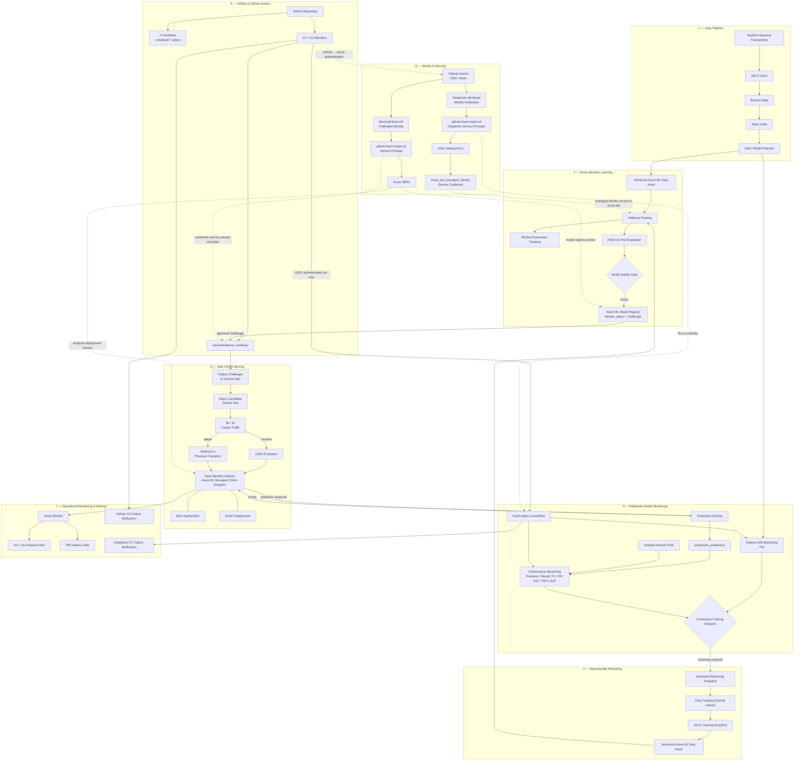

# Fraud Detection MLOps Architecture

## Overview

This document describes the technical architecture of the fraud-detection MLOps platform.

The system separates:

- data engineering
- model training
- model qualification
- model registry governance
- production monitoring
- Continuous Training
- Continuous Delivery
- online serving
- operational monitoring
- identity and access control

A central design principle is:

> **Training success is not release approval, and release approval is not production promotion.**

---

## End-to-End Architecture



---

## Data Plane

Historical PaySim transaction data enters the platform through ADLS Gen2 and is processed through Bronze, Silver and Gold Delta layers.

The Gold layer contains model-ready features used by:

- initial model training
- drift monitoring
- production monitoring
- retraining

---

## Model Training and Qualification

Azure Machine Learning owns the model-development boundary.

The lifecycle is:

```text
Versioned data
      ↓
XGBoost training
      ↓
MLflow experiment tracking
      ↓
validation-based threshold selection
      ↓
held-out test evaluation
      ↓
quality gate
      ↓
model registration
```

A training run cannot become deployment eligible unless it passes the configured model-quality gate.

---

## CT/CD Boundary

Continuous Training and Continuous Delivery are intentionally decoupled.

```text
Continuous Training
        ↓
qualified challenger
        ↓
Azure ML Model Registry
        ↓
Continuous Delivery
        ↓
production
```

The registry is the formal contract between the two systems.

---

## Continuous Training

Databricks owns model-health monitoring and retraining orchestration.

The production workflow is:

```text
fraud-mlops-ct-workflow
```

The workflow combines:

- feature drift
- delayed-label performance
- retraining policy
- versioned dataset creation
- Azure ML retraining trigger

Retraining is triggered only when an explicit monitoring condition is breached.

---

## Safe Production Release

The production endpoint uses two deployment slots:

```text
blue
green
```

A challenger is first deployed to the inactive slot.

Release sequence:

```text
inactive deployment
        ↓
direct smoke test
        ↓
90 / 10 traffic split
        ↓
candidate validation
        ↓
100% promotion
```

If validation fails after traffic shifting starts, production traffic is restored to the previous champion.

Azure Machine Learning documents this blue/green staged-traffic pattern as a safe rollout strategy. :chatgpt-content-reference{index="1"}

---

## Operational Monitoring

Operational serving health is monitored independently from model quality.

Azure Monitor tracks:

```text
HTTP failures
P95 request latency
endpoint operational health
```

Databricks tracks:

```text
feature drift
delayed-label model performance
CT state
workflow health
```

---

## Identity Boundaries

### GitHub → Azure

```text
GitHub Actions
      ↓
OIDC
      ↓
Microsoft Entra ID
      ↓
Service Principal
      ↓
Azure RBAC
      ↓
Azure ML
```

### GitHub → Databricks

```text
GitHub Actions
      ↓
GitHub OIDC
      ↓
Databricks Workload Identity Federation
      ↓
Databricks Service Principal
      ↓
fraud-mlops-ct-workflow
```

Databricks supports GitHub OIDC workload identity federation so external CI/CD workloads can authenticate without storing Databricks secrets. :chatgpt-content-reference{index="2"}

### Databricks Runtime

The production workflow executes as:

```text
github-fraud-mlops-cd
```

A Databricks job configured to Run As a service principal executes using that principal's identity and permissions regardless of who triggers the run. :chatgpt-content-reference{index="3"}

---

## Failure Containment

The architecture is designed to prevent one lifecycle failure from silently propagating into production.

Examples:

```text
CI failure
→ code is not release-ready

monitoring failure
→ CT stops

training failure
→ no challenger

quality-gate failure
→ no release-eligible model

candidate deployment failure
→ production remains unchanged

smoke-test failure
→ promotion stops

canary failure
→ traffic returns to previous champion
```